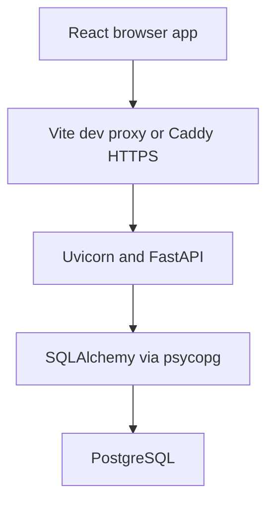

# Architecture

Week 1 implements account registration, login, logout and session restoration, plus an authenticated text feed as a reference for new features. Run and verify the stack using the [backend handoff](handoff/week-1-backend.md).

## System and request flow

Vite serves the development frontend and proxies API traffic to FastAPI on port 8000. The container setup builds the React SPA and serves it through Caddy on port 8443. Caddy forwards API requests to the API container. See [README](../README.md) for commands.

A protected HTTP request carries the session cookie. FastAPI resolves the active user, runs the relevant role or ownership check and uses a request-scoped database session. Successful writes commit explicitly. Exceptions roll back pending database work. Responses carry `X-Request-ID`, which also appears as `error.requestId` on errors.

| Backend module | Responsibility |
|---|---|
| `main.py` | App entry, router registration, liveness and database readiness |
| `config.py` | Settings from environment and root `.env` |
| `database.py` | Engine, ORM base and request-scoped database sessions |
| `models.py` | User, login session and post persistence |
| `schemas.py` | Account request and response validation |
| `security.py` | Argon2id hashing and verification |
| `auth.py` | Account routes, cookie handling and current-user dependency |
| `permissions.py` | Resource ownership and platform role checks |
| `posts.py` | Text post validation, listing, creation, editing and deletion |
| `errors.py` | Error envelope and request IDs |

The frontend uses React Router for navigation, Zustand for account state, shared UI components, and a typed HTTP client. Development via `make web-dev` uses the real API. Frontend tests via `make web-test` use mock authentication.

## Where to extend the system

- [Protocol](protocol.md) defines HTTP contracts and proposed WebSocket frames.
- [Data model](data-model.md) records tables, migrations and target relationships.
- [Product V1](product-v1.md) and [User flows](user-flows.md) record scope and product decisions.
- [Decision records](decisions/) explain technical choices. Shared Content is proposed. The independent text-post table is a Week 1 example.
- Realtime delivery still needs a server. Follow [ADR 0004](decisions/0004-realtime.md) when implementing persistence and reconnect behaviour.
- [Module evidence](module-claims.md) tracks review readiness per module. Use CI and the handoff smoke checks to verify each revision.

## Planned services

Media will validate file size and type on the server, store files outside the public web root, and enforce authorization on restricted downloads. Search will query domain data and apply the same visibility rules as direct reads. Keep private messages and restricted community content out of unauthorized results.

CI runs PostgreSQL migrations and backend tests plus frontend lint, type checking, tests and build. Check the latest workflow and use the handoff's browser walkthrough to confirm the release under review.
