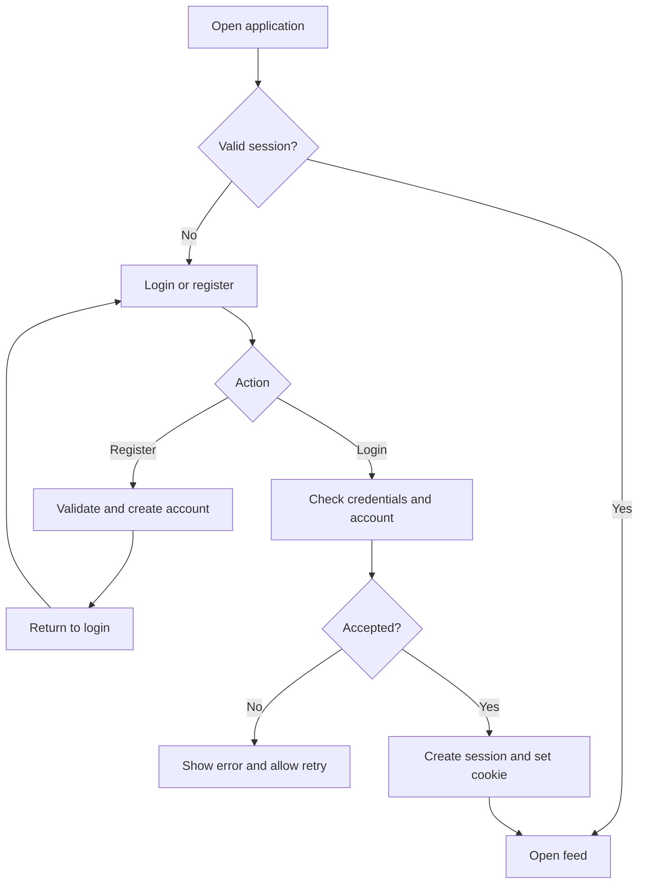
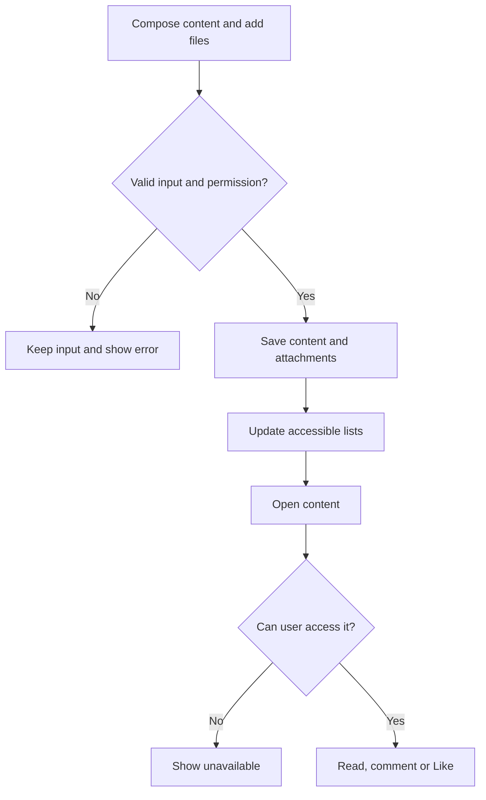
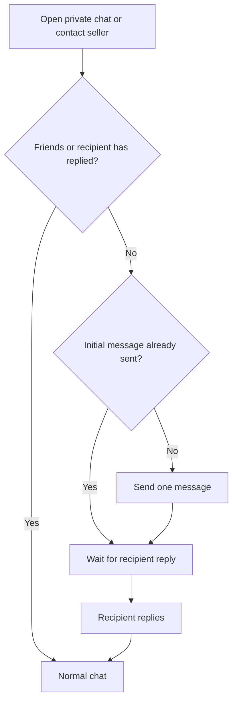

# User Flows — Community & Content Platform V1

Team design baseline · 5 November 2026

Scope and decision IDs: [Product V1](product-v1.md) · Schema: [Data model](data-model.md)

These flows describe the target behaviour. The backend foundation and the React scaffold are verified; authentication routes, the application UI and business flows still need implementation. Open decisions are tracked in Product V1.

## 1. Accounts and sessions

- Registration creates a regular user; clients cannot select their platform role. Duplicate email/username must not create another account.
- Successful registration returns to login. Remember me controls session persistence, not password storage.
- Refresh restores the current user through the session cookie. Expired/revoked sessions or disabled accounts require authentication again.
- Multiple devices may stay signed in. Logout revokes the current session and clears its cookie.
- Email verification: registration → verification email → verification → confirmed email; include a resend path.
- Password reset: request → email proof → new password → login.

**Open (D10):** lifetimes, unverified-account permissions, email credential format/retry limits, CSRF protection and whether password reset revokes all sessions. Proposed security behaviour: generic login/reset responses and short-lived, single-use verification/reset credentials.

## 2. Profiles, publishing and interaction

Users view profiles and edit their own details/avatar. Public fields and visitor access depend on D01.

- Choose `PUBLIC`, `FRIENDS` or `COMMUNITY` visibility. Recheck permissions for viewing, interaction and file access.
- Like toggles between liked/unliked; failed requests restore the previous UI state and repeated requests must not create duplicates.
- Only the author or an authorised moderator may edit/remove a resource. Feed, detail, search and attachments must reflect the same access/deletion state.
- Notification links recheck access when opened.

**Open:** shared content/feed structure (D05), deletion (D06), upload limits (D11) and flat/editable comments (D13).

## 3. Friends

| Current state | Action | Result |
|---|---|---|
| No relationship | Send request | Pending request and recipient notification |
| Outgoing pending | Cancel | Request cancelled |
| Incoming pending | Accept | Request accepted; friendship created |
| Incoming pending | Reject | Request rejected; users remain non-friends |
| Friends | Either user removes friendship | Friendship ends |

Users cannot request themselves or act on someone else's incoming request. Repeated actions and concurrent accept/cancel must not create duplicate friendships or contradictory results. Current friendship is separate from the historical request status.

**Open:** reverse requests and retry/cooldown rules (D12); effects on existing chat permissions (D02).

## 4. One-to-one messaging and seller contact

Friends can chat normally. Non-friends use the agreed first-contact rule below; seller enquiries follow the same rule (D02).

Reading is not a reply. Changing listing, device or page does not grant another initial message. Reuse one conversation per user pair.

| Situation | Expected behaviour |
|---|---|
| Refresh or another device | Load the same persisted history; active devices receive updates and share user-level read progress |
| Connection lost | Show connection state; fetch missed messages after reconnect |
| Send acknowledgement lost | Retry without duplicating the message; proposed client message ID, protocol to be agreed |
| Non-member knows a conversation ID | Deny reading and sending; derive identity from authentication |
| Multiple tabs/devices | Aggregate valid connections for presence |
| Listing sold/deleted | Show unavailable listing context where relevant; continued seller contact needs a rule |

**Open:** rejection/withdrawal, friendship changes and continued contact after sale (D02); history retention (D06); precise read/unread and offline timing (D15).

## 5. Other feature journeys

| Area | Main journey | Key exceptions or decisions |
|---|---|---|
| Communities | Create → owner membership → manage; browse → join → member content | Direct join and transfer-before-leaving are proposals (D07); membership changes must update content/file access |
| Blog | Draft → preview → publish → edit/delete | Draft access restricted to author; safe Markdown; D05/D06 |
| Events | Create → browse → join → receive updates; cancel participation | Full/cancelled event, duplicate entry, concurrent final place; cancellation releases capacity |
| Marketplace | Create listing → available/reserved/sold → contact seller | Validate price/status; apply the same D02 first-contact rule |
| Notifications | Save after business change → deliver → read → open target | Self-notification and grouping rules (D14); inaccessible targets must not leak content |
| Search | Query/filter → authorised results → page/sort → detail | Do not expose drafts, private chats or inaccessible community content through snippets/counts |
| Administration | Authenticate → check role → perform action → show outcome | Exact powers and protected actions need D08 approval |
| OAuth | Choose provider → authorise → validate callback → find/link identity → session | Provider/linking rules pending (D09); handle cancellation and invalid callbacks safely |

## 6. Shared acceptance scenarios

| Scenario | Pass condition |
|---|---|
| Register → login → refresh → logout | Current user restores correctly; passwords are never returned; revoked session cannot access protected routes |
| A publishes; B comments/Likes | Changes persist; B cannot edit A's post; visibility is enforced |
| A requests; B accepts; A messages | Both friendship lists agree; chat persists; outsiders cannot access it |
| Stranger contacts seller twice before reply | First message succeeds; second is blocked; reply enables normal chat |
| A sends while B is offline; B reconnects | Missing messages appear without duplicates, including on another signed-in device |
| Member is removed from a community | Detail, search and attachment access follow the updated membership rule |
| Two users claim the final event place | Only one succeeds; capacity is not exceeded |

Resolve the linked open decisions before treating affected scenarios as final acceptance criteria.
